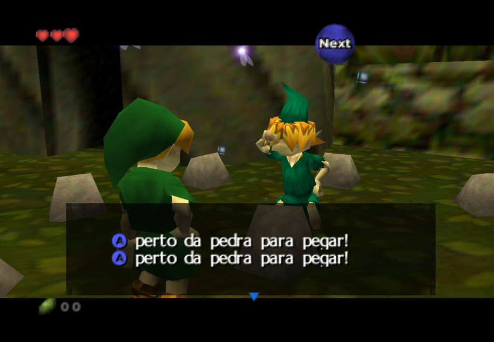
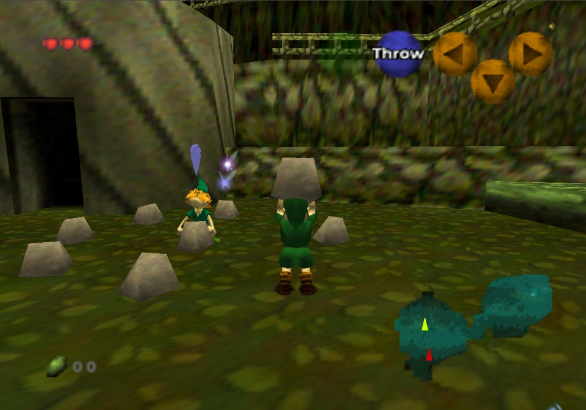

# Ocarina of Time PT-BR — versão para navegador

Uma adaptação de **The Legend of Zelda: Ocarina of Time** para jogar diretamente no navegador, com diálogos em português brasileiro, extração local dos recursos da ROM e suporte experimental a backups na nuvem.

  <a href="https://santosreislucas31-star.github.io/oot-cleanroom-ptbr/"><strong>▶ JOGAR AGORA</strong></a>

**[Abrir o jogo](https://santosreislucas31-star.github.io/oot-cleanroom-ptbr/)** · **[Ver o código-fonte](https://github.com/santosreislucas31-star/oot-cleanroom-ptbr)** · **[Acompanhar as compilações](https://github.com/santosreislucas31-star/oot-cleanroom-ptbr/actions)**

---

## Sobre o projeto

Este é um projeto pessoal criado a partir de uma necessidade simples: jogar Ocarina of Time no navegador sem precisar instalar um emulador ou configurar manualmente um ambiente complexo.

A aplicação é baseada no **[Ship of Harkinian](https://github.com/HarbourMasters/Shipwright)** e no port para navegador do fork **[zalo/Shipwright](https://github.com/zalo/Shipwright)**. A adaptação integra diálogos em português brasileiro, extração de recursos a partir de uma ROM escolhida pelo usuário e um sistema de saves locais com opção de backup e restauração pela nuvem.

### Como funciona a ROM

O jogo não inclui nem distribui uma ROM. Na primeira utilização em cada navegador ou dispositivo, a pessoa seleciona seu próprio arquivo compatível:

- `.z64`
- `.n64`
- `.v64`

O extrator ZAPD do Ship of Harkinian é executado no próprio navegador via WebAssembly para gerar os recursos necessários ao jogo. **O arquivo da ROM não é enviado ao servidor.** Os recursos extraídos ficam no armazenamento local do navegador (IndexedDB), permitindo reutilizá-los nas próximas visitas naquele mesmo navegador.

Por isso, ao usar outro navegador ou computador, é necessário selecionar a ROM novamente. O backup de saves na nuvem não inclui a ROM nem os recursos extraídos.

### Saves locais e backup na nuvem

O progresso é mantido localmente no navegador. A aplicação também oferece autenticação com GitHub, por meio do Supabase, e funções de backup e restauração dos arquivos de save:

1. Entre com sua conta GitHub pela interface do jogo.
2. Se houver um backup associado à conta, a aplicação oferece a opção de restaurá-lo.
3. Se houver apenas um save local, a interface permite escolher se ele será vinculado à conta ou mantido somente no navegador.
4. Os backups enviados à nuvem são organizados em pastas identificadas pelo ID da conta autenticada.

**Limitação conhecida:** o save local pertence ao navegador, não à conta GitHub. Ao trocar de conta no mesmo navegador, o progresso local existente pode continuar presente. A aplicação pede uma escolha para evitar uma associação acidental, mas o isolamento completo entre contas no mesmo navegador ainda não deve ser considerado garantido. Este recurso é experimental e foi desenvolvido para uso pessoal.

## Como jogar

1. Abra **[o jogo no navegador](https://santosreislucas31-star.github.io/oot-cleanroom-ptbr/)**.
2. Na primeira visita naquele navegador, selecione sua ROM compatível (`.z64`, `.n64` ou `.v64`).
3. Aguarde a extração dos recursos. O arquivo da ROM permanece no seu dispositivo.
4. Nas próximas visitas no mesmo navegador, os recursos extraídos serão reutilizados.
5. Opcionalmente, conecte sua conta GitHub para usar as funções de backup e restauração de saves.
6. Use o teclado ou conecte um controle compatível.

### Controles padrão

| Ação | Tecla |
|---|---|
| Analógico / movimento | W A S D |
| Botão A | X |
| Botão B | C |
| Botão Z | Z |
| Start | Espaço |
| Botões C | Setas direcionais |
| Direcional (D-pad) | T F G H |
| Menu do Ship of Harkinian | Esc |

Controles de jogo compatíveis também podem ser usados.

## Português brasileiro

A integração PT-BR inclui os dados de mensagens e o código que os incorpora ao port web. Na versão atual, por uma limitação de renderização da fonte no navegador, alguns caracteres acentuados são convertidos para equivalentes sem acento (por exemplo, **“coração” → “coracao”**). O texto está em português, mas a acentuação gráfica ainda é um ponto de melhoria.

## Tecnologias utilizadas

| Tecnologia | Aplicação |
|---|---|
| C/C++ | Motor do jogo, a partir do Ship of Harkinian |
| Emscripten / WebAssembly | Execução do motor e do extrator no navegador |
| WebGL | Renderização gráfica |
| JavaScript | Interface web, integração com autenticação e saves |
| IndexedDB / IDBFS | Armazenamento local dos recursos e saves |
| Supabase | Autenticação e armazenamento de backups |
| GitHub OAuth | Login da conta |
| Python | Validações, preparação de recursos e aplicação de patches |
| GitHub Actions | Compilação automatizada |
| GitHub Pages | Hospedagem da versão web |

## Experimento com inteligência artificial

Este projeto também teve como objetivo explorar o potencial de uma IA gratuita como principal ferramenta de desenvolvimento.

O código específico criado para esta adaptação foi produzido pelo ChatGPT a partir dos objetivos, requisitos e orientações definidos durante o processo. A participação humana ficou concentrada na concepção da ideia, definição do que deveria ser construído, decisões de direção, execução dos testes, avaliação dos resultados e identificação dos problemas que precisavam ser corrigidos.

O desenvolvimento aconteceu de forma iterativa: a IA propunha e implementava alterações; os resultados eram executados e avaliados para orientar as próximas etapas. O projeto documenta, na prática, tanto as possibilidades quanto os limites de utilizar IA no desenvolvimento de software.

**Transparência:** esta adaptação não criou a engine do zero. Ela utiliza projetos e componentes preexistentes, listados nos créditos. A afirmação sobre o uso de IA refere-se ao código e às modificações específicas conduzidas para esta versão.

## Créditos e licenças

- **Ship of Harkinian:** [HarbourMasters/Shipwright](https://github.com/HarbourMasters/Shipwright).
- **Port para navegador:** [zalo/Shipwright](https://github.com/zalo/Shipwright).
- **Extração de recursos:** ZAPD / OTRExporter, incluídos no Ship of Harkinian.
- **Dados de mensagens PT-BR:** integração baseada no conjunto de mensagens atribuído a Geraldo Cruzeiro presente no projeto.

Respeite as licenças e os créditos dos projetos e componentes de origem. **The Legend of Zelda** e seus personagens são propriedade de seus respectivos titulares. Este é um projeto independente de fãs, sem afiliação ou endosso da Nintendo.

---

## Status

**Concluído para uso pessoal.** A versão publicada foi aberta e testada pelo responsável pelo projeto. O jogo, a seleção da ROM e o carregamento dos recursos foram utilizados na prática. O backup em nuvem está implementado, mas seu comportamento ao alternar contas no mesmo navegador tem a limitação descrita acima.

- [x] Execução do jogo no navegador.
- [x] Seleção de ROM pelo usuário e extração local dos recursos.
- [x] Reutilização dos recursos extraídos no mesmo navegador.
- [x] Integração de diálogos em português brasileiro.
- [x] Autenticação com GitHub via Supabase.
- [x] Backup e restauração de saves na nuvem.
- [ ] Acentuação completa na fonte do jogo.
- [ ] Isolamento de saves totalmente validado ao alternar contas no mesmo navegador.

**Acesse:** https://santosreislucas31-star.github.io/oot-cleanroom-ptbr/

## Capturas de tela

As imagens abaixo mostram capturas do projeto em execução no navegador.

<table>
  <tr>
    <td align="center"></td>
    <td align="center"></td>
  </tr>
  <tr>
    <td align="center"></td>
    <td align="center"></td>
    <td align="center"></td>
  </tr>
</table>
