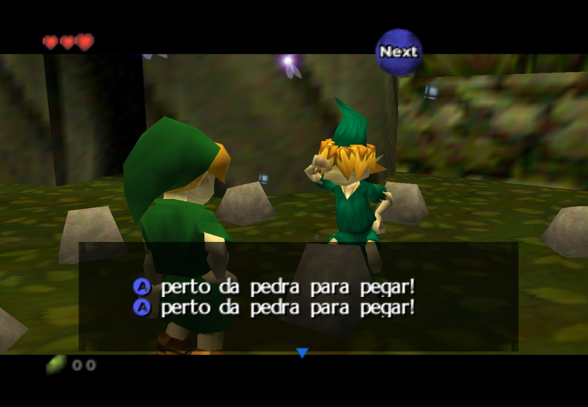
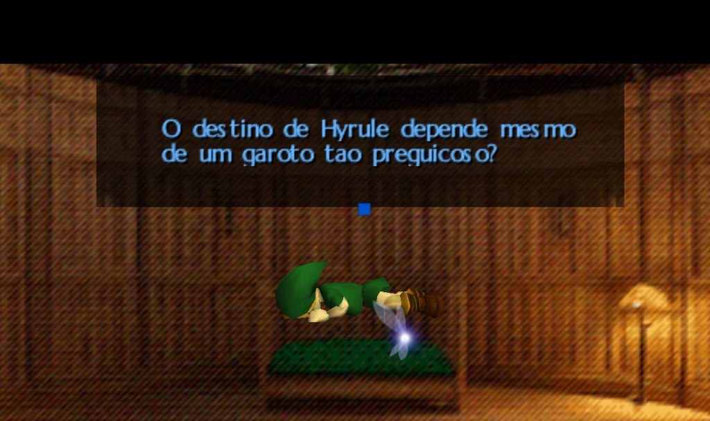
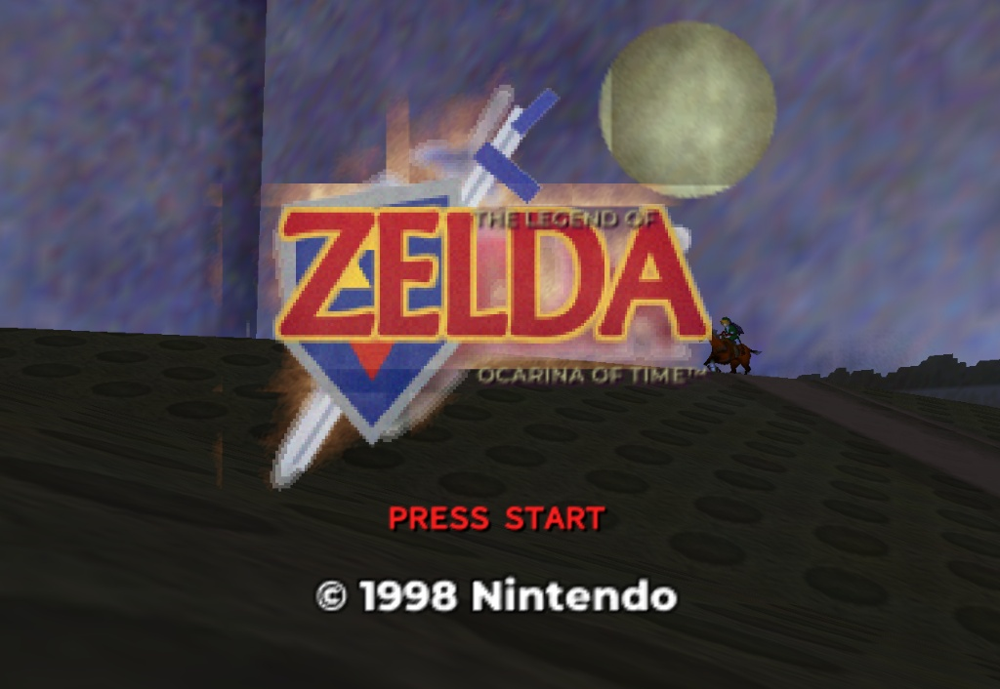
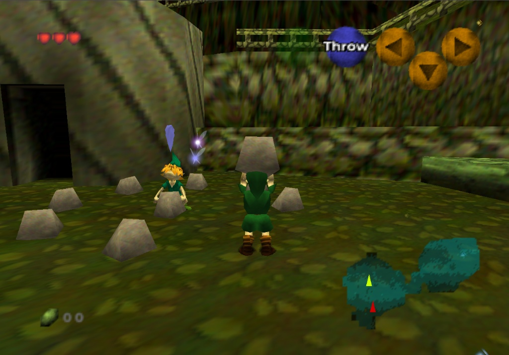
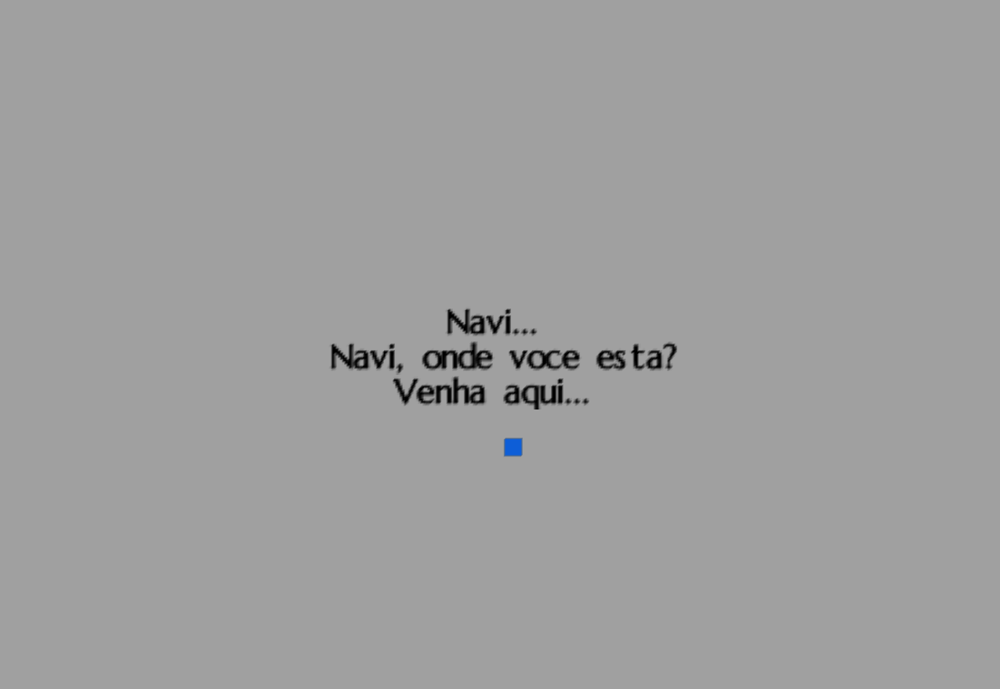

# Ocarina of Time PT-BR — versão para navegador

Jogue **The Legend of Zelda: Ocarina of Time** diretamente no navegador, com diálogos em português brasileiro.

  <a href="https://santosreislucas31-star.github.io/oot-cleanroom-ptbr/"><strong>▶ JOGAR AGORA</strong></a>

**[Abrir o jogo](https://santosreislucas31-star.github.io/oot-cleanroom-ptbr/)** · **[Ver o código-fonte](https://github.com/santosreislucas31-star/oot-cleanroom-ptbr)** · **[Acompanhar as compilações](https://github.com/santosreislucas31-star/oot-cleanroom-ptbr/actions)**

---

## Sobre o projeto

Este repositório mantém uma versão web de Ocarina of Time baseada no projeto **[Ship of Harkinian](https://github.com/HarbourMasters/Shipwright)** e no port para navegador desenvolvido no fork **[zalo/Shipwright](https://github.com/zalo/Shipwright)**.

O trabalho parte da base **[andrewnakas/oot-cleanroom](https://github.com/andrewnakas/oot-cleanroom)**, que reconstrói os recursos necessários ao jogo em um formato clean-room. Esta adaptação integra dados de diálogos em PT-BR, ajustes para a execução no navegador e um fluxo automatizado de compilação e publicação.

O objetivo é deixar uma versão jogável acessível por um link, sem exigir que a pessoa configure um ambiente de desenvolvimento ou forneça uma ROM ao site.

## Como jogar

1. Abra **[o jogo no navegador](https://santosreislucas31-star.github.io/oot-cleanroom-ptbr/)**.
2. Aguarde o carregamento inicial dos arquivos. Na primeira visita, isso pode levar alguns minutos dependendo da conexão.
3. Use o teclado ou conecte um controle compatível.

### Controles padrão

| Ação | Tecla |
|---|---|
| Analógico / movimento | W A S D |
| Botão A | X |
| Botão B | C |
| Botão Z | Z |
| Start | Espaço |
| Botões C | Setas direcionais |
| Direcional (D-pad) | T F G H |
| Menu do Ship of Harkinian | Esc |

Controles de jogo compatíveis também podem ser usados.

## Português brasileiro

A integração PT-BR inclui os dados de mensagens e o código que os incorpora ao port web. A versão atual prioriza a legibilidade durante a gameplay: por uma limitação de renderização da fonte no navegador, caracteres acentuados são convertidos para equivalentes sem acento (por exemplo, **“coração” → “coracao”**).

Isso significa que o texto está em português, mas a acentuação gráfica ainda não está completa. A correção da fonte e a compatibilidade dos caracteres continuam sendo pontos de melhoria.

## Tecnologias e fluxo de publicação

- **C/C++** — código do motor do jogo.
- **Ship of Harkinian** — engine usada para executar Ocarina of Time.
- **Emscripten / WebAssembly** — compilação do código para execução no navegador.
- **WebGL** — renderização gráfica no navegador.
- **Python** — validações, preparação dos recursos e aplicação dos patches.
- **GitHub Actions** — compila o projeto nos servidores do GitHub.
- **GitHub Pages** — hospeda a versão web publicada.

O workflow **Build PT-BR web game** executa a validação dos dados, prepara os recursos, compila o projeto e publica o conteúdo gerado no GitHub Pages. A execução é iniciada manualmente pela aba **Actions**.

## Estrutura relacionada ao PT-BR

- `ports/soh/ptbr/` — dados e cabeçalhos da integração de mensagens e fonte.
- `ports/soh/port_patches.py` — aplica as alterações necessárias ao código do port web.
- `ports/soh/validate_ptbr.py` — valida os dados de mensagens antes da compilação.
- `.github/workflows/build-web-ptbr.yml` — pipeline de compilação e deploy.
- `ports/soh/make_site.py` — reúne os arquivos compilados em um site estático.

## Créditos e licenças

Este trabalho é uma adaptação de projetos existentes, não uma engine criada do zero.

- **Ship of Harkinian:** [HarbourMasters/Shipwright](https://github.com/HarbourMasters/Shipwright).
- **Port Emscripten/WebGL:** [zalo/Shipwright](https://github.com/zalo/Shipwright).
- **Base clean-room:** [andrewnakas/oot-cleanroom](https://github.com/andrewnakas/oot-cleanroom).
- **Dados de mensagens PT-BR:** integração baseada no conjunto de mensagens atribuído a Geraldo Cruzeiro presente no projeto.

Respeite as licenças e os créditos dos projetos e componentes de origem. **The Legend of Zelda** e seus personagens são propriedade de seus respectivos titulares. Este é um projeto independente de fãs, sem afiliação ou endosso da Nintendo.

---

## Status

- [x] Compilação web concluída no GitHub Actions.
- [x] Publicação automática no GitHub Pages.
- [x] Jogo acessível pelo navegador.
- [x] Integração de diálogos PT-BR incluída na build publicada.
- [ ] Acentuação completa na fonte do jogo.
- [ ] Testes mais amplos em diferentes navegadores, dispositivos e controles.

**Acesse:** https://santosreislucas31-star.github.io/oot-cleanroom-ptbr/

## Capturas de tela

As imagens abaixo mostram capturas do projeto em execução no navegador.

<table>
  <tr>
    <td align="center"></td>
    <td align="center"></td>
  </tr>
  <tr>
    <td align="center"></td>
    <td align="center"></td>
    <td align="center"></td>
  </tr>
</table>

