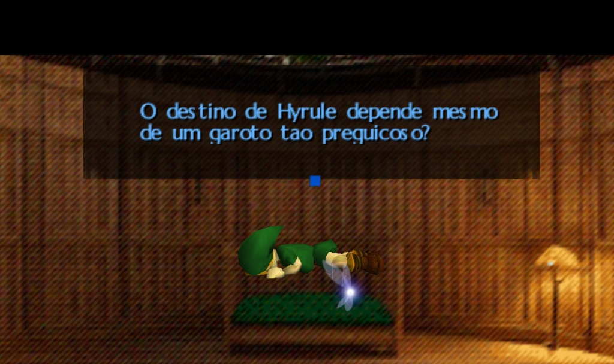
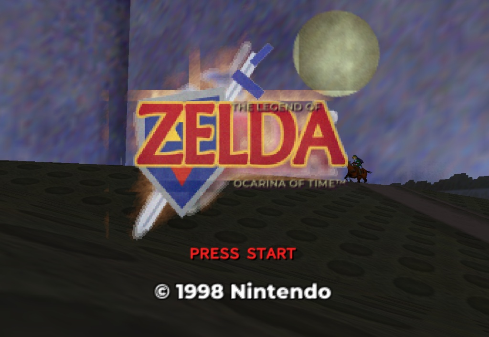

# Ocarina of Time PT-BR — versão para navegador

Uma adaptação de **The Legend of Zelda: Ocarina of Time** para execução no navegador, com diálogos em português brasileiro.

  <a href="https://santosreislucas31-star.github.io/oot-cleanroom-ptbr/"><strong>▶ JOGAR AGORA</strong></a>

**[Abrir o jogo](https://santosreislucas31-star.github.io/oot-cleanroom-ptbr/)** · **[Ver o código-fonte](https://github.com/santosreislucas31-star/oot-cleanroom-ptbr)** · **[Acompanhar as compilações](https://github.com/santosreislucas31-star/oot-cleanroom-ptbr/actions)**

---

## Visão geral

Este é um projeto pessoal criado a partir de uma necessidade simples: jogar Ocarina of Time no navegador sem precisar instalar um emulador ou configurar manualmente um ambiente complexo.

O repositório mantém uma versão web baseada no projeto **[Ship of Harkinian](https://github.com/HarbourMasters/Shipwright)** e no port para navegador desenvolvido no fork **[zalo/Shipwright](https://github.com/zalo/Shipwright)**. Também utiliza como referência a base **[andrewnakas/oot-cleanroom](https://github.com/andrewnakas/oot-cleanroom)** para a reconstrução dos recursos necessários ao jogo.

A adaptação reúne a integração de diálogos em português brasileiro, ajustes para execução no navegador e um fluxo automatizado de compilação e publicação.

## Um experimento com inteligência artificial

Além de criar uma versão jogável, este projeto teve outro objetivo: **explorar até onde seria possível chegar utilizando uma IA gratuita como principal ferramenta de desenvolvimento**.

O código específico criado para a implementação deste projeto foi produzido pelo ChatGPT a partir das instruções e dos objetivos definidos durante o trabalho. A participação humana ficou concentrada na concepção da ideia, definição dos requisitos, escolhas de direção, avaliação dos resultados, testes e identificação dos problemas que precisavam ser resolvidos.

O projeto foi conduzido de forma iterativa: a IA propunha e implementava soluções, enquanto os resultados eram executados e avaliados para orientar os próximos ajustes. A intenção é documentar o potencial — e também os limites — do uso de IA no desenvolvimento de software, inclusive em um projeto que envolve tecnologias e ferramentas diferentes.

**Transparência:** este repositório não é uma engine criada do zero. Ele utiliza projetos e componentes preexistentes, identificados na seção de créditos. A descrição sobre o uso de IA refere-se ao desenvolvimento e às modificações conduzidas especificamente para esta adaptação.

## Funcionalidades e tecnologias

- Execução do jogo no navegador por meio de **WebAssembly**.
- Renderização gráfica com **WebGL**.
- Integração de diálogos em **português brasileiro**.
- Preparação e validação automatizadas dos dados do projeto.
- Compilação automatizada com **GitHub Actions**.
- Hospedagem da versão web pelo **GitHub Pages**.

### Tecnologias utilizadas

| Tecnologia | Aplicação no projeto |
|---|---|
| C/C++ | Código do motor de jogo herdado da base Ship of Harkinian |
| Emscripten / WebAssembly | Compilação para execução no navegador |
| WebGL | Renderização gráfica |
| JavaScript | Integrações e lógica da aplicação web |
| Python | Validações, preparação de recursos e aplicação de patches |
| Git e GitHub | Versionamento e organização do código |
| GitHub Actions | Automação de compilação e publicação |
| GitHub Pages | Hospedagem da versão web |

## Como jogar

1. Abra **[o jogo no navegador](https://santosreislucas31-star.github.io/oot-cleanroom-ptbr/)**.
2. Aguarde o carregamento inicial dos arquivos. Na primeira visita, isso pode levar alguns minutos dependendo da conexão.
3. Use o teclado ou conecte um controle compatível.

### Controles padrão

| Ação | Tecla |
|---|---|
| Analógico / movimento | W A S D |
| Botão A | X |
| Botão B | C |
| Botão Z | Z |
| Start | Espaço |
| Botões C | Setas direcionais |
| Direcional (D-pad) | T F G H |
| Menu do Ship of Harkinian | Esc |

Controles de jogo compatíveis também podem ser usados.

## Português brasileiro

A integração PT-BR inclui os dados de mensagens e o código que os incorpora ao port web. A versão atual prioriza a legibilidade durante a gameplay: por uma limitação de renderização da fonte no navegador, caracteres acentuados são convertidos para equivalentes sem acento (por exemplo, **“coração” → “coracao”**).

Isso significa que o texto está em português, mas a acentuação gráfica ainda não está completa. A correção da fonte e a compatibilidade dos caracteres permanecem como possíveis melhorias.

## Estrutura relacionada ao PT-BR

- `ports/soh/ptbr/` — dados e cabeçalhos da integração de mensagens e fonte.
- `ports/soh/port_patches.py` — aplica as alterações necessárias ao código do port web.
- `ports/soh/validate_ptbr.py` — valida os dados de mensagens antes da compilação.
- `.github/workflows/build-web-ptbr.yml` — pipeline de compilação e deploy.
- `ports/soh/make_site.py` — reúne os arquivos compilados em um site estático.

## Créditos e licenças

Este trabalho é uma adaptação de projetos existentes, não uma engine criada do zero.

- **Ship of Harkinian:** [HarbourMasters/Shipwright](https://github.com/HarbourMasters/Shipwright).
- **Port Emscripten/WebGL:** [zalo/Shipwright](https://github.com/zalo/Shipwright).
- **Base clean-room:** [andrewnakas/oot-cleanroom](https://github.com/andrewnakas/oot-cleanroom).
- **Dados de mensagens PT-BR:** integração baseada no conjunto de mensagens atribuído a Geraldo Cruzeiro presente no projeto.

Respeite as licenças e os créditos dos projetos e componentes de origem. **The Legend of Zelda** e seus personagens são propriedade de seus respectivos titulares. Este é um projeto independente de fãs, sem afiliação ou endosso da Nintendo.

---

## Status do projeto

**Concluído para uso pessoal.** A versão publicada foi executada e testada pelo responsável pelo projeto. Melhorias e testes adicionais podem ser realizados futuramente, mas não fazem parte do objetivo atual.

- [x] Compilação web concluída no GitHub Actions.
- [x] Publicação no GitHub Pages.
- [x] Jogo acessível e executável pelo navegador.
- [x] Integração de diálogos PT-BR incluída na build publicada.
- [ ] Acentuação completa na fonte do jogo.
- [ ] Testes mais amplos em diferentes navegadores, dispositivos e controles.

**Acesse:** https://santosreislucas31-star.github.io/oot-cleanroom-ptbr/

## Capturas de tela

As imagens abaixo mostram capturas do projeto em execução no navegador.

<table>
  <tr>
    <td align="center"></td>
    <td align="center"></td>
  </tr>
  <tr>
    <td align="center"></td>
    <td align="center"></td>
    <td align="center"></td>
  </tr>
</table>
